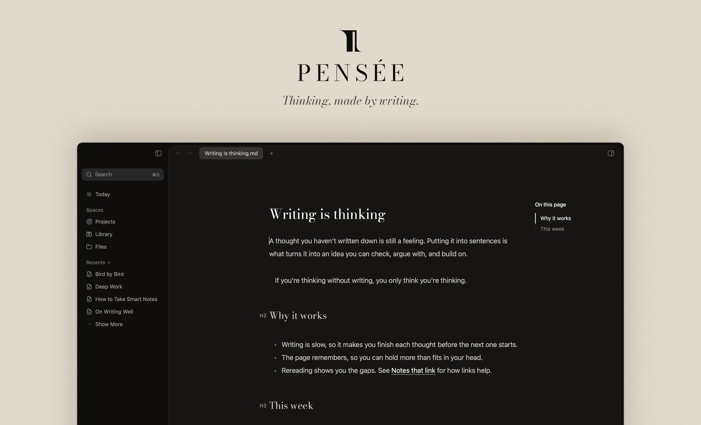
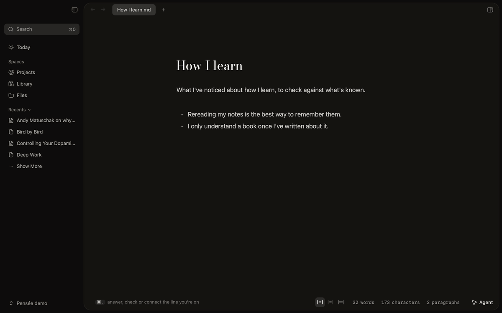
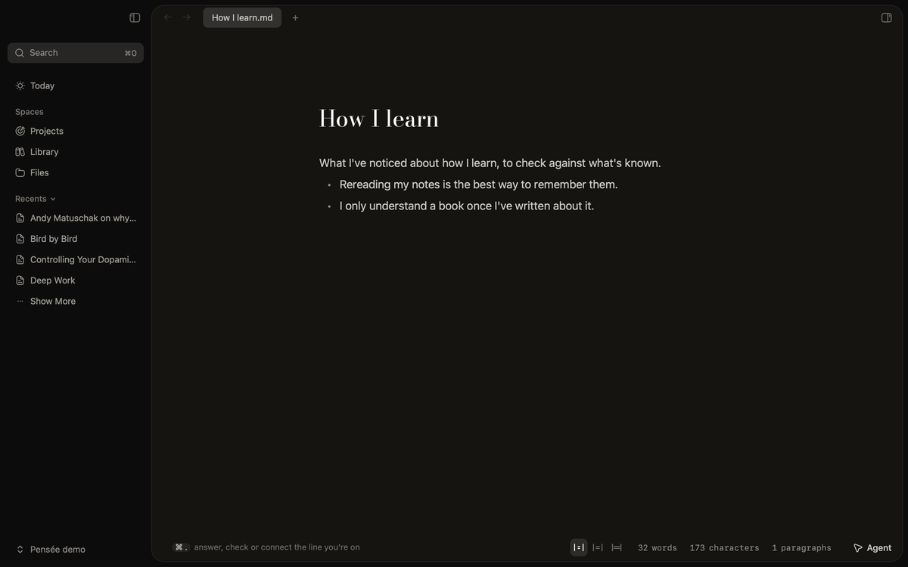
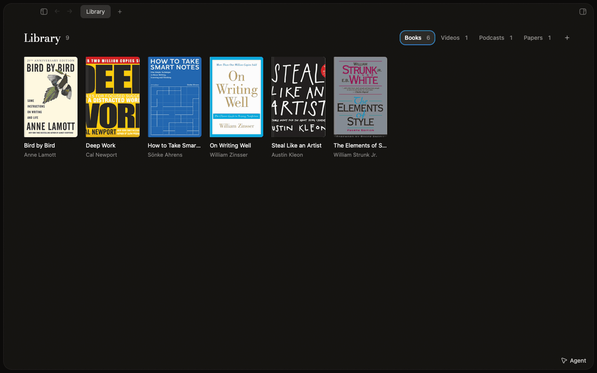
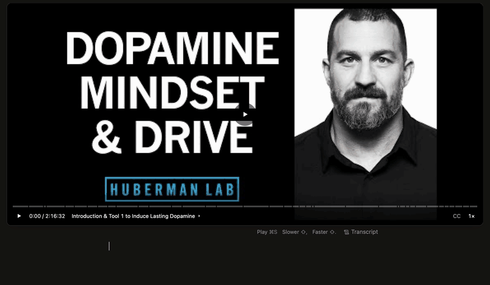
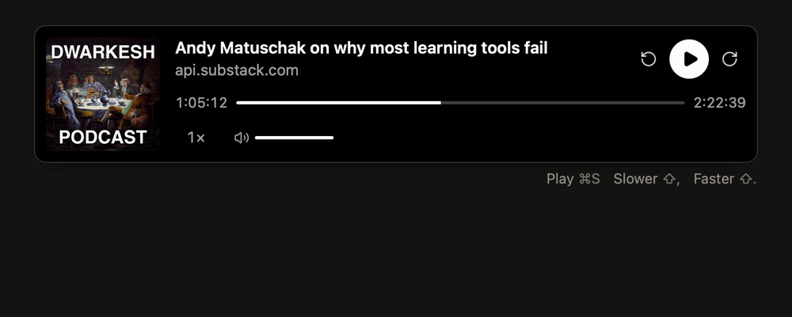

# Pensée



Thinking, made by writing.

I'm making Pensée for people like me: neurodivergent, with ADHD or a brain that works a little differently. We collect everything: the article, the video, the book a friend mentioned, the idea that shows up at 2am. Very little of it gets digested, and we wish it did, because digesting is how you come to understand the world and yourself.

Pensée is where the collecting turns into understanding. Your memory goes on the page, so your head doesn't have to hold it all. You write about each new thing you meet in your own words, and the notes link up into something you can come back to. It's meant to feel calm enough to get into the zone, and safe: every note is a file in a folder on your own computer.

The AI is a second pen, not a ghostwriter. Press ⌘. on a line and it can check it against papers, connect it to your other notes, or answer it. Each time, the conclusion is yours to write.



_Check (⌘. @) on a claim: the pen cites papers for and against it. You write the call._



_Connect (⌘. [) on a line: the pen brings back what your other notes say about it. You write how they connect._


_Answer (⌘. !) on a question: the answer stays sealed until you've written your own take. Then it opens, and Tab combines the two into one list._

Whatever you collect becomes a note you write in, beside its source.



_A book opens beside its note. Highlight a line and it lands in the note. Click it later and the page comes back, and your own thought goes under it._



_A YouTube note plays the video beside its transcript. Click a line to play from it, and ⌘S pins the moment to the line you're writing._



_A podcast note works the same way: ⌘S plays, and ⌘S again pins the moment._

When an idea needs a map, put a board in the note.


_Drop a card next to another and it docks there, joined by an arrow._

Notes are plain markdown, so they open in Obsidian or any editor. Pensée also has Projects (a list, kanban or timeline of your project notes) and the Agent, a Claude chat that can read and edit your pages.

## Install

Macs with Apple Silicon (M1 and later). With [Homebrew](https://brew.sh):

```bash
brew install --cask feiyinwang/tap/pensee
```

Or without it:

```bash
curl -fsSL https://raw.githubusercontent.com/feiyinwang/Pensee/master/install.sh | bash
```

Pensée isn't notarized by Apple yet, so both clear the quarantine flag macOS puts on downloads. Update with `brew upgrade --cask pensee` or the curl line again.

The second pen and the Agent run on [Claude Code](https://docs.anthropic.com/en/docs/claude-code). Install it, and Pensée signs you in from Settings.

## Privacy

Pensée is local-first. Neither the app nor the website collects usage data.

## Development

Tauri v2, React, Zustand, CodeMirror and Rust, with Vite+ (`vp`) as the toolchain:

```bash
vp install
```

```bash
vp dev
```

Check with `vp check` and `vp test`, and in `apps/desktop/src-tauri` with `cargo test`, `cargo clippy` and `cargo fmt --check`.

- `apps/desktop/`: the app (React in `src/`, Rust in `src-tauri/src/`). `apps/website/`: the landing page. `docs/` and `SPECs/`: docs and specs.
- `scripts/ship-local.sh` builds the app and installs it in `/Applications`. `scripts/release.sh` publishes a release after you bump `version` in `apps/desktop/src-tauri/tauri.conf.json`.
- `apps/desktop/e2e/readme-gifs/film.sh` films the GIFs above again.

## License

GPL v3; see [`LICENSE`](./LICENSE). Pensée is a modified version of [Writer](https://github.com/joelbqz/writer-computer) by Joel ([@joelbqz](https://github.com/joelbqz)), changed substantially since the fork.
