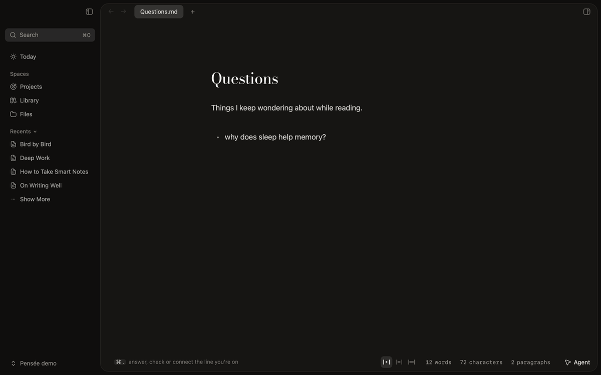
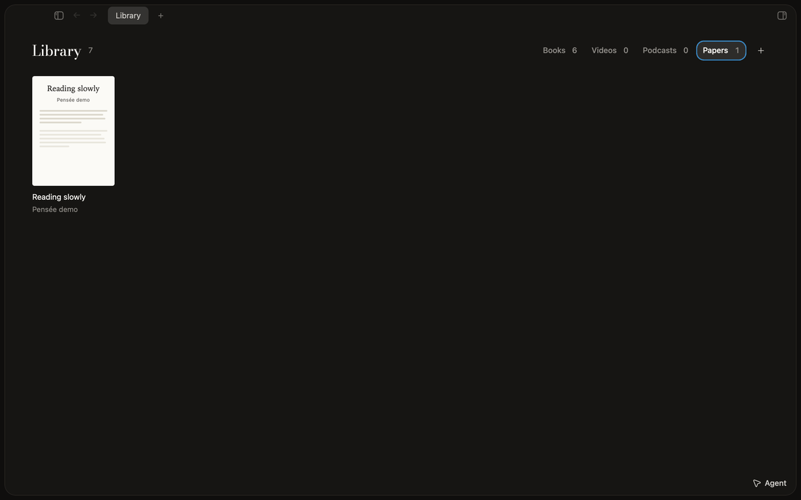
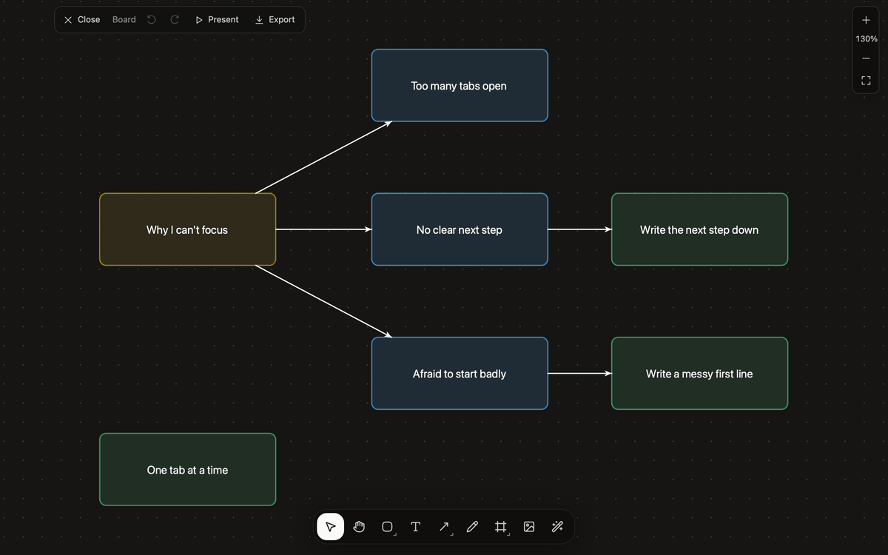

# Pensée

Thinking, made by writing.

I'm making Pensée for people like me, with ADHD or a brain that works a little differently. We collect everything: the article, the video, the book a friend mentioned, the idea that shows up at 2am. Very little of it gets digested, and we wish it did, because digesting is how you come to understand the world and yourself.

Pensée is where the collecting turns into understanding. Your memory goes on the page, so your head doesn't have to hold it all. You write about each new thing you meet in your own words, and the notes link up into something you can come back to. It's meant to feel calm enough to get into the zone, and safe: every note is a file in a folder on your own computer.

The AI is a second pen, not a ghostwriter. It answers a question only after you've written your own take. It lays out the evidence on both sides of a claim and leaves the call to you. It shows where a line connects to something you wrote months ago, and you write how they connect. Your ideas stay yours.



_Press ⌘. on a question and the pen writes an answer, sealed. Write your own take first, and it opens beside it._

Every note is a markdown file in your own folder, so it opens in Obsidian or any editor. Around the notes:

- **Library** keeps books, videos, podcasts and papers as notes, and opens PDFs and EPUBs beside their page so highlights land in it.
- **Boards** live inside a note: cards and arrows for mapping out an idea. Drag a card next to another and it docks there, joined by an arrow.
- **Projects** shows your project notes as a list, a kanban or a timeline, and writes changes back to each note's properties.
- **YouTube notes** play the video inside its note, and each note you take can be pinned to the moment it was written.
- The **Agent** chat is Claude with your pages in view: it reads and edits them, and explains or defines what you select in a book.



_A paper in Library opens its PDF beside its note, so what you write sits next to what you read._



_On a board, drop a card beside another and it docks into place with an arrow._

It is built with Tauri v2, React, Zustand, CodeMirror, and Rust. The app keeps documents on disk, respects workspace `.gitignore` rules, supports multiple windows, and renders extended markdown such as tables and Mermaid diagrams. The logo and brand are described in [`docs/brand.md`](./docs/brand.md).

## Repository

- `apps/desktop/` — Tauri desktop app.
- `apps/desktop/src/` — React frontend.
- `apps/desktop/src-tauri/src/` — Rust commands, workspace state, watcher, and CLI integration.
- `apps/website/` — landing page.
- `assets/brand/` — logo sources and the icon render script.
- `docs/` — project and agent workflow docs.
- `SPECs/` — feature specs and design notes.

## Development

This repo uses Vite+ through the `vp` CLI. Use `vp` instead of calling the package manager or Vite tooling directly.

```bash
vp install
```

```bash
vp dev
```

## Validation

```bash
vp check
```

```bash
vp test
```

Rust validation runs from the Tauri crate (`apps/desktop/src-tauri`):

```bash
cargo test
```

```bash
cargo clippy
```

```bash
cargo fmt --check
```

## Privacy

Pensée is local-first and stays that way. It collects no usage data, and
neither does the website.

## Building

Build and install the app locally with `scripts/ship-local.sh`. It makes a release build, signs it ad hoc and installs it in `/Applications`. The app doesn't check for updates.

## License

Pensée is free software under the GNU General Public License v3.0; see [`LICENSE`](./LICENSE). It is a modified version of [Writer](https://github.com/joelbqz/writer-computer) by Joel ([@joelbqz](https://github.com/joelbqz)), changed substantially since the fork.
